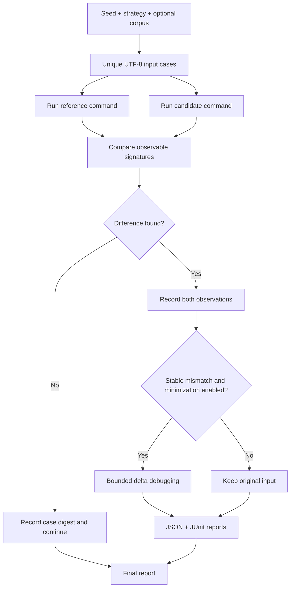

<div align="center">

# TwinCheck

### Differential testing for black-box software compatibility

**Give TwinCheck two implementations. It explores inputs, detects behavioral differences, shrinks stable failures, and exports evidence you can replay in CI.**

[](https://github.com/ArnabIITP/TwinCheck/actions/workflows/ci.yml)
[](https://github.com/ArnabIITP/TwinCheck/stargazers)
[](https://github.com/ArnabIITP/TwinCheck/network/members)
[](https://github.com/ArnabIITP/TwinCheck/issues)
[](https://github.com/ArnabIITP/TwinCheck/commits/main)
[](LICENSE)


</div>

> **Project status: early alpha.** TwinCheck is an actively developed prototype, not yet a mature general-purpose fuzzing platform, not a security sandbox, and not a proof of program equivalence. This repository is private during development. GitHub/third-party statistic badges may not resolve for private repositories; they query GitHub dynamically and are expected to become useful after the project is made public.

## Why TwinCheck exists

Replacing a parser, porting a tool to another language, implementing a compatible API, or migrating a data-processing library creates a difficult question: *does the replacement behave like the original on the inputs that matter?* Unit tests often cover expected examples but miss edge cases, error handling, formatting quirks, boundary values and differences in process behavior.

TwinCheck is intended to make those differences observable and actionable. Its initial target is a black-box command-line interface, so the reference and candidate may be implemented in different languages. It generates repeatable text inputs, runs both programs, compares their observable output and exit behavior, and records enough information to reproduce a finding.

The longer-term research direction is an **evidence-first compatibility lab**: structured input adapters, instability-aware comparisons, minimized counterexamples, portable regression artifacts, and eventually execution adapters for APIs and stateful protocols. AI-assisted input suggestions may be added later, but a model will never be treated as proof that a difference exists. A finding must be backed by actual executions.

## What is implemented today

| Capability | Current behavior |
| --- | --- |
| Deterministic input generation | Mixed, text, integer-boundary and JSON-shaped text strategies; seeded pseudo-random inputs |
| Known-corpus support | Reads UTF-8 files from a directory in stable path order, before generated cases |
| Black-box execution | Runs two commands without invoking a shell; supports stdin or a `{input}` argv placeholder |
| Observable comparison | stdout, stderr, exit code, timeout, output truncation and repeated-run instability |
| Output policy | Per-stream retained-byte cap; output is redirected to temporary files instead of unbounded in-memory pipes |
| Compatibility contracts | Versioned JSON contract chooses exact or structural-JSON output comparison, JSON Pointer ignores for volatile fields, and whether exit codes/timeouts matter |
| Contract provenance | Every report stores the normalized contract and SHA-256 fingerprint so teams can audit exactly which rules produced a result |
| Failure minimization | Bounded delta-debugging for stable mismatches; explicitly reports the trial budget |
| Reproduction | JSON reports retain the input and SHA-256 digest; `replay` re-runs a chosen finding with explicitly supplied commands |
| Counterexample packs | Export findings into a validated portable regression pack that pins the compatibility contract and verifies every case hash before replay |
| CI output | Human-readable summary, JSON evidence report, and JUnit XML with one testcase per tested input |
| Project quality | Standard-library tests, GitHub Actions CI, issue templates, MIT license and security/contribution policies |

This is a narrow foundation by design. It does not yet analyze arbitrary binaries, reconstruct protocols, observe filesystem/network side effects, perform coverage-guided instrumentation, or safely execute untrusted code.

## Quick start

Requires Python 3.11 or newer.

```bash
git clone https://github.com/ArnabIITP/TwinCheck.git
cd TwinCheck
python -m pip install -e .
```

Run the included example. The candidate deliberately mishandles some whitespace, so the command should find a difference and exit with status `1`.

```bash
twincheck compare \
  --reference "python examples/reference.py" \
  --candidate "python examples/candidate.py" \
  --strategy text \
  --cases 8 \
  --seed 7 \
  --minimize \
  --max-minimization-trials 8 \
  --output reports/demo.json \
  --junit reports/demo-junit.xml
```

The nonzero exit code is intentional: it makes a detected difference suitable for a CI gate. `reports/demo.json` contains the exact failing input and process evidence; JUnit XML is available to CI test-report parsers.

Run the tests locally:

```bash
python -m unittest discover -s tests -v
python -m twincheck --help
python -m twincheck compare --help
python -m twincheck replay --help
```

There are no runtime third-party dependencies. The packaging backend is a build-time dependency.

## How a comparison works



Each finding is based on measured process behavior. A clean run means only that TwinCheck did not observe a difference in the cases it executed. It is never evidence that the programs are equivalent for all possible inputs.

## CLI guide

### Generate and compare cases

```bash
twincheck compare \
  --reference "python reference.py" \
  --candidate "python replacement.py" \
  --strategy mixed \
  --cases 500 \
  --seed 42 \
  --timeout 5 \
  --repeat 2 \
  --max-output-bytes 1000000 \
  --minimize \
  --output reports/compatibility.json \
  --junit reports/compatibility.xml
```

**Important options**

| Option | Meaning |
| --- | --- |
| `--cases N` | Maximum number of unique input cases; default `100` |
| `--seed N` | Seed for reproducible input generation; default `0` |
| `--strategy` | `mixed`, `text`, `integer`, or `json` |
| `--corpus DIR` | Try local UTF-8 corpus files before generated inputs |
| `--timeout SECONDS` | Per-target timeout; default `5` seconds |
| `--repeat N` | Run each target N times for each input to expose observable instability; default `1` |
| `--max-output-bytes N` | Retain at most N bytes per stdout/stderr stream; default `1,000,000` |
| `--minimize` | Try to shrink stable findings using delta debugging |
| `--max-minimize N` | Maximum findings to minimize; default `1` |
| `--max-minimization-trials N` | Maximum deletion trials per finding; default `30` |
| `--normalize-eol` | Compare CRLF, CR and LF as equivalent |
| `--ignore-trailing-whitespace` | Ignore spaces and tabs at line ends |
| `--ignore-stderr` | Exclude stderr from behavioral comparison |
| `--ignore-exit-code` | Exclude return code from comparison |
| `--output PATH` | Write full JSON evidence to a file |
| `--junit PATH` | Write JUnit XML for CI ingestion |
| `--format json` | Write JSON to stdout instead of the text summary |

### Input strategies

- **`text`** prioritizes empty input, whitespace, line endings, Unicode, control characters, long strings and random text.
- **`integer`** prioritizes signed integer boundaries, zero/sign variants and large numeric strings.
- **`json`** generates JSON-compatible scalars, arrays and nested objects as text. It does not yet validate inputs against a user-provided JSON Schema.
- **`mixed`** combines the known edge-case families and samples from each generator.

Known edge cases are attempted first. Generated values are deterministic for a given TwinCheck version, strategy, requested count and seed. Reproducibility across different future versions is not guaranteed unless the version is pinned.

### Pass input through stdin or argv

By default, the full input text is written to stdin. Commands are parsed into arguments and launched with `shell=False`.

```bash
# stdin: most general option
twincheck compare --reference "python ref.py" --candidate "python replacement.py" --cases 100

# argv substitution: useful for single-argument command-line tools
twincheck compare \
  --reference "python ref.py {input}" \
  --candidate "python replacement.py {input}" \
  --cases 100
```

If any command argument contains `{input}`, the token is replaced and stdin is empty. NUL characters and platform-specific argument restrictions may make some generated text unsuitable for argv; stdin is the preferred transport for such cases.

### Reuse a known corpus

Put UTF-8 input files in a directory. Files are recursively loaded in sorted path order, then de-duplicated. If the corpus has fewer entries than requested, generated inputs fill the remaining budget.

```bash
twincheck compare \
  --reference "python ref.py" \
  --candidate "python replacement.py" \
  --corpus tests/corpus \
  --cases 250
```

### Repeat runs and instability

`--repeat 3` executes both targets three times for each input. If a target's compared observable signature changes across its own runs, the finding includes `reference_unstable` or `candidate_unstable`. TwinCheck retains the per-run observations for findings where `repeat > 1`.

Repeated execution is a detector, not a cure for nondeterminism. Time, random seeds, concurrent services, locale, environment variables and external state may still influence behavior. If a target is unstable, rerun it with controlled dependencies before treating the cross-implementation mismatch as a deterministic regression.

### Replay a saved finding

A report may contain commands from a previous environment, but TwinCheck never executes those stored command strings automatically. Supply the commands explicitly when replaying an input.

```bash
twincheck replay \
  --report reports/compatibility.json \
  --finding 1 \
  --reference "python reference.py" \
  --candidate "python replacement.py" \
  --repeat 3 \
  --output reports/replay.json
```

The finding number is 1-based and refers to its position in the source report. Finding replay reports record the source report path and source input digest. Pack replay reports also include the pack path, case count, source report digest, and pinned contract hash.

## Compatibility contracts — the first semantic layer

Byte-for-byte comparison is often too strict for JSON-facing programs: responses can be equivalent even when object key order or a generated request ID changes. TwinCheck's compatibility contract is a small, versioned policy file that defines what must remain the same. It is not an API schema validator and it does not guess what the product considers important.

Try the included reference/replacement pair:

```bash
twincheck compare \
  --reference "python examples/json_reference.py" \
  --candidate "python examples/json_candidate.py" \
  --strategy json \
  --cases 5 \
  --seed 17 \
  --contract examples/contracts/json-api-v1.json \
  --output reports/json-compatibility.json
```

Both examples emit the same meaningful JSON response, but `request_id` and `meta.generated_at` intentionally differ. The example contract ignores those two volatile paths; the run should complete with no behavioral differences. Remove those ignore rules to see TwinCheck find a mismatch. The command is a real local execution, not a mocked comparison.

### Contract format

```json
{
  "schema_version": 1,
  "name": "json-api-response-compatibility",
  "stdout": {
    "mode": "json",
    "ignore_paths": ["/request_id", "/meta/generated_at"]
  },
  "stderr": { "mode": "exact" },
  "compare_exit_code": true,
  "compare_timeout": true
}
```

Use `--contract path/to/contract.json` with `compare`, `replay`, or `replay-pack` (where it must match the pack-pinned policy). The format is documented by [`docs/compatibility-contract-v1.schema.json`](docs/compatibility-contract-v1.schema.json); a full example is in [`examples/contracts/json-api-v1.json`](examples/contracts/json-api-v1.json).

- `mode: "exact"` compares output text under the selected CLI normalization flags.
- `mode: "json"` parses output as JSON, ignores insignificant whitespace and object-key order, and compares array order and remaining values. Numbers are compared by numeric value (`1` and `1.0` are treated as the same JSON number).
- `ignore_paths` accepts non-root RFC 6901 JSON Pointers, such as `/meta/generated_at` or `/a~1b/~0key`. It is valid only for JSON mode. Missing paths are no-ops so one contract can span compatible response variants.
- Invalid JSON is always reported as `stdout_invalid_json` or `stderr_invalid_json`; two equally malformed strings do not pass a JSON contract.
- `compare_exit_code` and `compare_timeout` default to `true`. Set either to `false` only when the behavior is intentionally outside the compatibility promise.
- The report embeds the normalized contract and its SHA-256 fingerprint. Review the policy before treating a green run as evidence: ignoring a field removes it from this comparison, whether or not that field is business-critical.

The contract is applied consistently during repeated-run stability checks and minimization. Thus a minimized counterexample preserves the mismatch under the same semantic rules as the original run.

## Turn a discovery into a regression suite

A finding should not disappear into a JSON report after the bug is fixed. `export-pack` converts findings into a portable directory containing exact input files, a manifest, and the normalized contract that originally defined equivalence. Duplicate inputs are stored only once. The pack verifies each input SHA-256 before replay and refuses a mismatched contract; target commands must always be supplied explicitly.

```bash
# Start with a report containing one or more findings.
twincheck export-pack \
  --report reports/compatibility.json \
  --output tests/twincheck-regressions

# After fixing the candidate, replay every counterexample as a regression suite.
twincheck replay-pack \
  --pack tests/twincheck-regressions \
  --reference "python reference.py" \
  --candidate "python replacement.py" \
  --repeat 2 \
  --output reports/regression-replay.json \
  --junit reports/regression-replay.xml
```

A clean replay exits `0`; a reproduced mismatch exits `1`, making the pack useful as a compatibility gate. Commit packs only when their inputs are safe to share—counterexamples can contain secrets, proprietary data, or personally identifiable information. The pack manifest format is described in [`docs/counterexample-pack-v1.schema.json`](docs/counterexample-pack-v1.schema.json).

## Reports and exit codes

Each JSON report contains metadata, a per-case execution index with input SHA-256 and difference categories, detailed findings with exact input and process observations, timing, generator configuration, and limitations. `docs/report-schema-v1.schema.json` describes report schema v1.2; the compatibility rules have their own independently versioned contract schema. The schema is versioned because reports are intended to become portable regression artifacts.

| Exit code | Meaning |
| ---: | --- |
| `0` | No differences found in tested cases |
| `1` | One or more differences, instability indicators, or incomplete-output observations found |
| `2` | Invalid arguments/input/report or a command could not be started |
| `130` | Interrupted by the user |

A JUnit report emits one testcase per executed input. It includes hashes and categories in failure detail rather than writing raw test inputs into CI logs. Keep the JSON report as the evidence artifact. Inputs can contain secrets, personal data or proprietary content, so review report artifacts before uploading or sharing them.

## Safety and correctness boundaries

- TwinCheck does **not** invoke a shell, but a command executable can still perform arbitrary actions with your operating-system permissions.
- This is not a sandbox. Run only commands you trust. Do not expose TwinCheck as a service that executes user-supplied commands.
- Output is redirected to temporary files and read back with a per-stream retention cap. When the cap is exceeded, the runner flags the observation and attempts to stop the target; a very fast process can finish before the next poll tick, so the file may briefly exceed the configured cap.
- A timeout is not a complete resource policy. CPU, memory, disk access, network access, filesystem changes and OS-specific spawned-process behavior are not fully isolated.
- Captured output is decoded as UTF-8 with replacement for invalid sequences; it is not byte-exact binary comparison.
- Timing is recorded for diagnosis but not used as a difference by default because timing noise can create false positives.
- The minimizer is bounded delta debugging. It seeks a smaller input preserving the observed mismatch categories; it does not guarantee a globally minimal counterexample.
- For unstable targets or truncated outputs, a finding may require manual revalidation.

See [Threat Model](docs/threat-model.md), [Architecture](docs/architecture.md), and [Design Decisions](docs/design-decisions.md).

## Project direction

TwinCheck is not trying to be a generic wrapper around an LLM. Its long-term hypothesis is that compatibility investigations become more useful when every claim is backed by reproducible executions and a portable counterexample. Areas for future work are sequenced in the [project plan](docs/project-plan.md) and [roadmap](docs/roadmap.md): schema-aware generation, richer normalized traces, API/protocol adapters, regression bundles, and an independently reviewed isolated-execution backend.

### Roadmap summary

| Stage | Goal | Status |
| --- | --- | --- |
| v0.1 | Deterministic CLI differential testing, minimization, JSON report, tests and CI | Prototype implemented |
| v0.2 | Replay, JUnit output, repeated-run instability detection, bounded capture, versioned semantic output contracts, and contract-pinned regression packs | Implemented in the current development branch; needs broader cross-platform CI validation |
| v0.3 | JSON Schema-aware input generation and adapter interface for request/response compatibility | Planned |
| v0.4 | Isolated execution and richer filesystem/network observations | Planned, security-sensitive |
| v1.0 | Stable APIs, benchmark corpus and trusted compatibility workflow | Not yet close to complete |

## Development

```bash
python -m pip install -e .
python -m unittest discover -s tests -v
python -m twincheck --help
```

A small end-to-end smoke benchmark is documented under [`benchmarks/`](benchmarks/README.md). Benchmark results must be published with the Python version, operating system, number of cases, rounds, and exact commands. A result from one machine is not a general performance claim.

## Contributing

Please read [CONTRIBUTING.md](CONTRIBUTING.md) and [SECURITY.md](SECURITY.md). Favor focused changes with reproducible tests. Do not commit real secrets, private production inputs, customer data or proprietary software captures.

## License

MIT. See [LICENSE](LICENSE).
