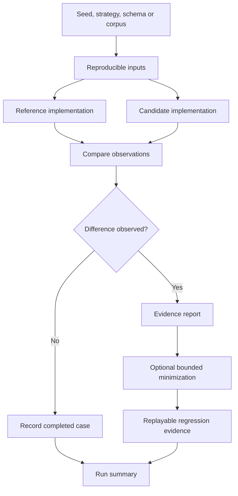

<div align="center">

# TwinCheck

**Evidence-first differential testing for software compatibility.**

Give TwinCheck a reference implementation and a candidate replacement. It runs both against the same reproducible inputs, compares their observable behavior, and turns differences into evidence you can replay and use in regression testing.

[](https://github.com/ArnabIITP/TwinCheck/actions/workflows/ci.yml)
[](https://www.python.org/)
[](LICENSE)
[](CHANGELOG.md)

</div>

> **Alpha software.** TwinCheck is actively developed and its CLI and file formats may evolve before 1.0. It is a testing tool, not a proof of program equivalence, a production monitoring system, or a security sandbox. TwinCheck 0.12.0a1 is published on [PyPI](https://pypi.org/project/twincheck/0.12.0a1/). Install this pre-release explicitly with `python -m pip install --pre twincheck==0.12.0a1`. The source-installation instructions below are for contributors working from the repository.

## Why TwinCheck?

A replacement can pass its unit tests and still behave differently from the system it is meant to replace. Differences may appear in edge cases, error handling, whitespace, status codes, response bodies, session state, or sequences of operations.

TwinCheck helps investigate that compatibility gap by comparing two implementations as black boxes. It does not need access to their source code or require them to use the same programming language.

Typical use cases include:

- Replacing a legacy command-line tool with a new implementation.
- Porting a parser, formatter, or data-processing utility.
- Checking whether two local API implementations behave consistently.
- Testing a migration before switching traffic or removing the old implementation.
- Preserving a discovered mismatch as a replayable regression case.

## Get started

**Requirements:** Python 3.11 or newer.

Install the published alpha from PyPI:

```bash
python -m pip install --pre twincheck==0.12.0a1
```

Check the installed command:

```bash
twincheck --help
```

To work from the latest source instead, clone the repository and install it in editable mode:

```bash
git clone https://github.com/ArnabIITP/TwinCheck.git
cd TwinCheck
python -m pip install -e .
```

Create a directory for the report files, then run the included command-line example:

```bash
mkdir -p reports
twincheck compare \
  --reference "python examples/reference.py" \
  --candidate "python examples/candidate.py" \
  --strategy text \
  --cases 8 \
  --seed 7 \
  --minimize \
  --max-minimization-trials 8 \
  --output reports/demo.json \
  --junit reports/demo-junit.xml
```

The example candidate deliberately differs from the reference. TwinCheck should report a mismatch and exit with status `1`. That nonzero exit is intentional: a detected difference can fail a CI job. The JSON report contains the executed input and observations; the JUnit file can be consumed by CI test-report tools.

For a complete walkthrough, see the **[Quick-start guide](docs/quickstart.md)**.

## What TwinCheck can do today

| Area | Current capability |
| --- | --- |
| Command-line comparison | Run two commands without a shell, passing the same input through stdin or an argv placeholder |
| Input generation | Seeded text, integer-boundary, JSON-shaped and documented JSON Schema-subset generation |
| Known corpora | Replay UTF-8 corpus files in stable path order before generated cases |
| Behavioral observations | Compare stdout, stderr, exit status, timeout behavior, output truncation and repeated-run instability |
| Compatibility contracts | Choose exact or structural JSON comparison, ignore selected JSON Pointer paths, and configure exit-code/timeout comparison |
| Local HTTP comparison | Send matching JSON requests to two loopback services and compare status, selected headers and response bodies |
| Stateful HTTP workflows | Run ordered multi-request workflows with independent cookies, response-value capture, reset checks and bounded exploration |
| Failure minimization | Reduce stable mismatches using bounded delta debugging |
| Replay and regression evidence | Save JSON reports, export portable counterexample packs, and replay findings against explicitly supplied targets |
| CI reporting | Produce human-readable summaries, JSON evidence and JUnit XML |
| Python API | Versioned API v1 for command-line comparison, contracts and report helpers |

The implementation is deliberately bounded. See [current limitations](docs/roadmap.md) and the [release and compatibility policy](docs/release-process.md) before relying on it in automation.

## How it works

1. **Choose two targets.** Provide the reference and candidate commands, or two local HTTP service URLs.
2. **Define the comparison.** Use defaults or a versioned compatibility contract to specify which observations matter.
3. **Generate or provide inputs.** Set a seed and optionally provide a corpus or supported JSON Schema.
4. **Execute both targets.** TwinCheck runs matching cases and records observable behavior.
5. **Inspect differences.** Findings include the input, observations, comparison metadata and provenance.
6. **Minimize and replay.** Where supported, shrink stable mismatches and preserve them as regression evidence.



A clean run means only that no difference was observed in the cases executed under the selected comparison policy. It does **not** establish equivalence for all possible inputs.

## Examples

### Compare command-line programs

```bash
twincheck compare \
  --reference "python reference.py" \
  --candidate "python replacement.py" \
  --strategy mixed \
  --cases 500 \
  --seed 42 \
  --repeat 2 \
  --timeout 5 \
  --max-output-bytes 1000000 \
  --minimize \
  --output reports/compatibility.json \
  --junit reports/compatibility.xml
```

Inputs can be supplied through stdin or a `{input}` argument placeholder. Commands are launched without invoking a shell. See the [CLI guide](docs/quickstart.md#command-line-comparison) for more options.

### Compare local HTTP implementations

Start two local example services:

```bash
python examples/http_service.py --port 8001 --delta 0
python examples/http_service.py --port 8002 --delta 1
```

In another terminal:

```bash
twincheck compare-http \
  --reference-url http://127.0.0.1:8001 \
  --candidate-url http://127.0.0.1:8002 \
  --path /quotes \
  --method POST \
  --schema examples/schemas/quote-request-v1.json \
  --contract examples/contracts/http-api-v1.json \
  --cases 25 \
  --seed 42 \
  --output reports/http-compatibility.json
```

HTTP targets are restricted to loopback addresses. This adapter is intended for local test services, not remote API scanning.

### Compare stateful API workflows

TwinCheck can execute a user-authored sequence such as create a cart, add an item, and read the cart back. It keeps reference and candidate cookies separate, supports scalar response capture for later requests, and can apply a user-defined reset workflow with explicit health assertions.

See the [stateful workflow walkthrough](docs/quickstart.md#stateful-http-workflow) and the checked-in [sequence examples](examples/sequences/).

## Python API

The supported Python API v1 covers command-line comparisons, compatibility contracts and report helpers:

```python
import shlex
import sys

from twincheck import compare_commands, write_json_report

report = compare_commands(
    shlex.join([sys.executable, "reference.py"]),
    shlex.join([sys.executable, "replacement.py"]),
    cases=100,
    seed=42,
)

write_json_report("reports/compatibility.json", report)
```

Only documented exports are covered by API v1. Stateful HTTP comparison and exploration are currently CLI features. Read the [Python API reference](docs/python-api.md) and [compatibility policy](docs/release-process.md).

## Benchmarks and evidence

The repository includes pinned, synthetic compatibility corpora for cart and booking/reservation workflows. Their fixtures, schemas and expected outcomes are versioned so that results can be reproduced.

These are **synthetic validation fixtures**, not independent real-world benchmarks. They do not establish a general detection rate, performance advantage, or production readiness. See the [benchmark protocol](benchmarks/README.md).

## Safety and data handling

TwinCheck is **not a sandbox**. It launches configured commands with the permissions of the current user. A target can access files, use the network, spawn processes and consume resources available to that user. Run only commands and services you trust and are authorized to test.

Reports, replay artifacts and workflow definitions can contain failing inputs and service observations. Treat them as potentially sensitive. Use synthetic data where possible and review evidence before sharing it. See [SECURITY.md](SECURITY.md) for the project's security boundaries and vulnerability reporting guidance.

## Documentation

- [Quick start and CLI walkthrough](docs/quickstart.md)
- [Python API v1](docs/python-api.md)
- [JSON Schema generation support](docs/schema-generation.md)
- [Stateful HTTP sequence format](docs/stateful-http-sequence-v1.schema.json)
- [Benchmark protocol and limitations](benchmarks/README.md)
- [Release and compatibility policy](docs/release-process.md)
- [Architecture and design](docs/architecture.md)
- [Roadmap and known limitations](docs/roadmap.md)
- [Security policy](SECURITY.md)
- [Contributing guide](CONTRIBUTING.md)
- [Code of Conduct](CODE_OF_CONDUCT.md)
- [Changelog](CHANGELOG.md)

## Development

Install the optional test dependency and run the suite:

```bash
python -m pip install -e ".[test]"
python -m unittest discover -s tests -v
```

Build and verify distributable artifacts:

```bash
python -m pip install --upgrade build twine
python -m build --outdir dist
python scripts/verify_distribution.py --dist-dir dist
```

See [CONTRIBUTING.md](CONTRIBUTING.md) for development expectations and [docs/release-process.md](docs/release-process.md) for release validation.

## Contributing

Bug reports, reproducible examples, documentation improvements and focused pull requests are welcome. Please remove credentials, customer information and proprietary data from reports before sharing them.

Start with [CONTRIBUTING.md](CONTRIBUTING.md), review open [issues](https://github.com/ArnabIITP/TwinCheck/issues), and use the issue templates when reporting a problem.

## License

TwinCheck is released under the [MIT License](LICENSE).
